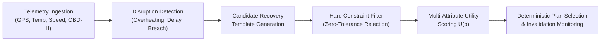
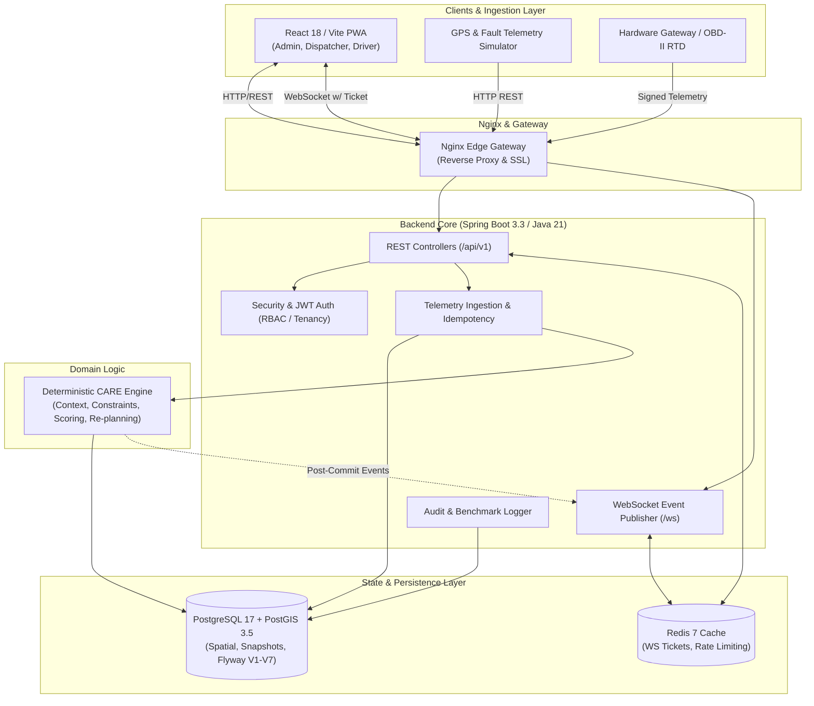
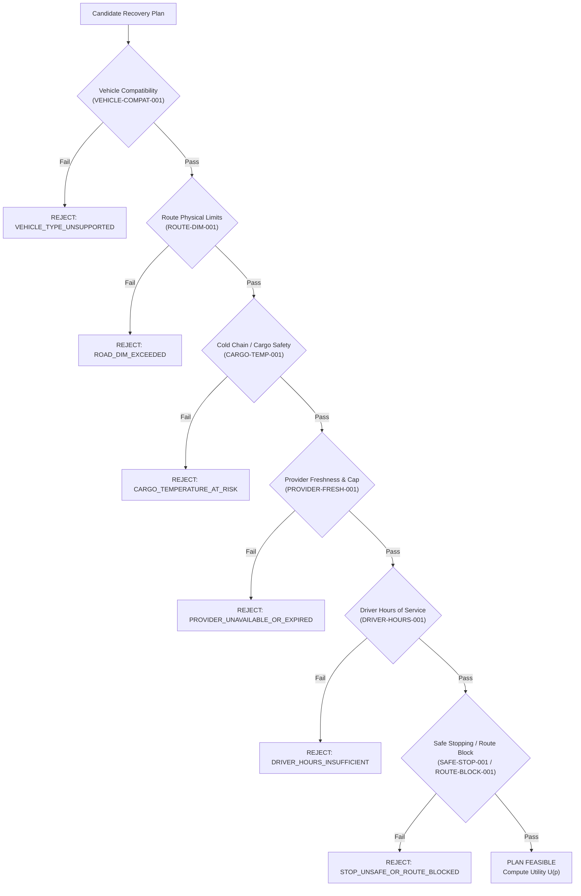
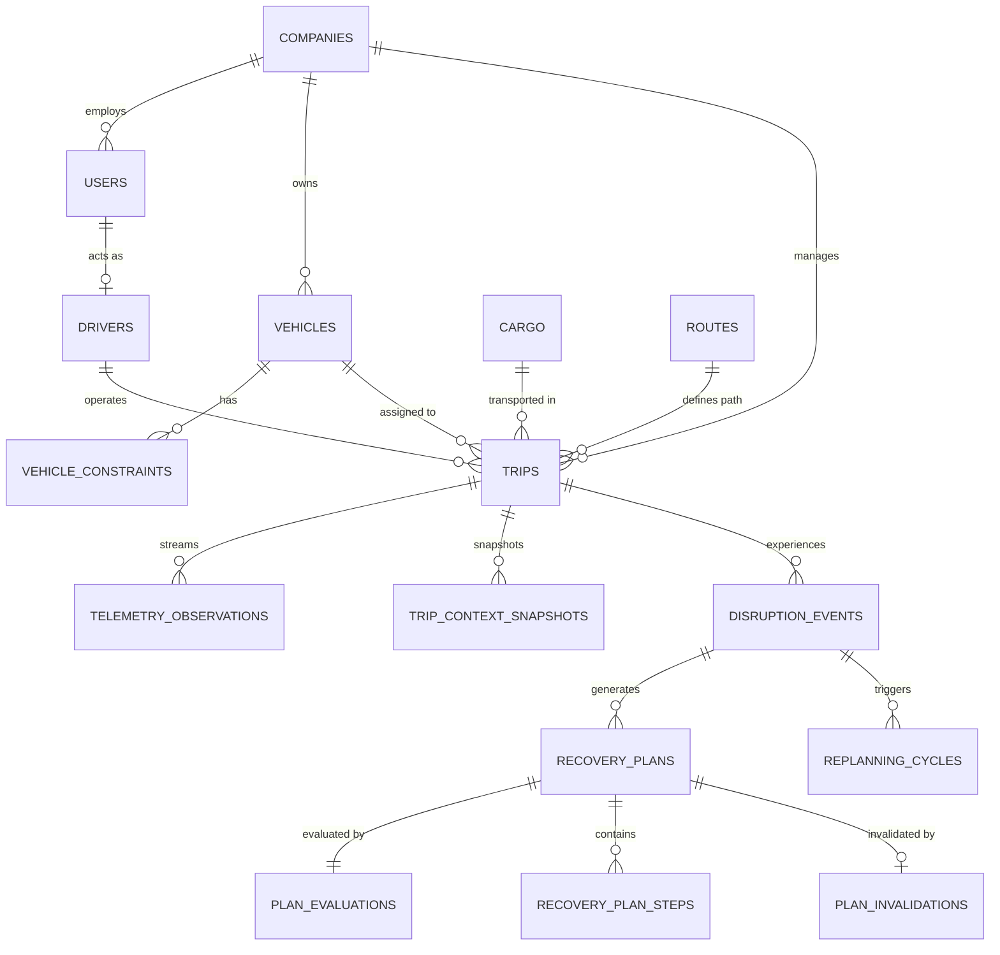
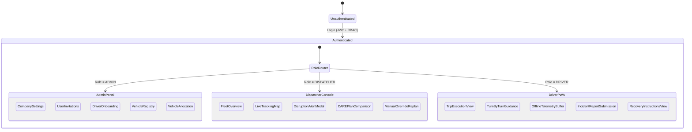
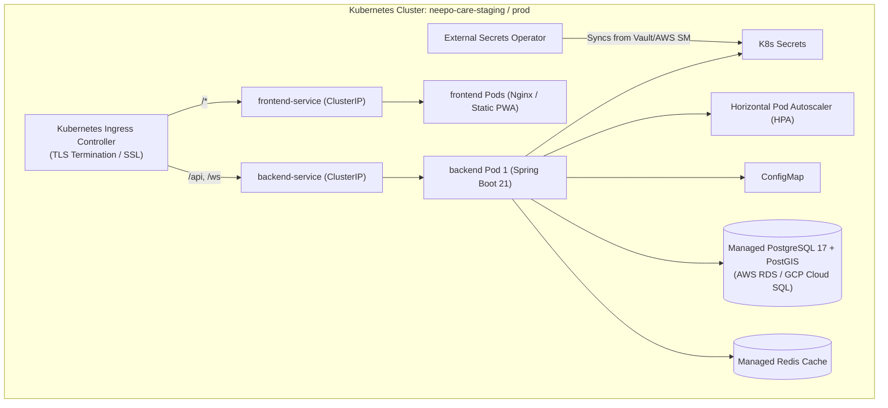

# NEEPO-CARE: System Architecture & Technical Project Document

**Project:** Explainable Logistics Disruption & Recovery Engine (NEEPO-CARE)  
**Version:** 1.0.0 (Integration Baseline on `feature/full-stack-integration`)  
**Date:** October 2026  
**Status:** Production-Hardened Integration Prototype  

---

## 1. Executive Summary

### 1.1 Purpose & Vision
**NEEPO-CARE** (Context-Aware Recovery Engine) is an enterprise-grade, explainable logistics disruption-recovery platform designed for high-consequence fleet operations (e.g., refrigerated pharmaceutical and food cold chains, hazardous materials, and time-critical industrial freight).

Traditional logistics recovery systems rely either on manual human dispatcher triage (slow, high error rate, subjective) or opaque "black-box" machine learning / nearest-neighbor heuristics (unpredictable, unexplainable, failure to satisfy legal and physical constraints). NEEPO-CARE delivers **deterministic, mathematically verifiable, and explainable disruption detection and recovery planning**.



### 1.2 Core Value Proposition
- **Explainability Over Black Boxes:** Every plan approval or rejection generates unambiguous, machine- and human-readable explanation codes backed by immutable evidence.
- **Strict Hard/Soft Separation:** Unsafe plans (e.g., weight limits exceeded, cargo temperature breach predicted, expired provider contracts, driver duty hours violated) are **strictly rejected**—never compensated by high scores in other areas.
- **Deterministic & Reversible Decisions:** Given identical input context snapshots, CARE produces bit-for-bit identical plan rankings and selections with predictable tie-breaking.
- **Dynamic Invalidation & Autonomous Re-planning:** Real-time monitoring automatically invalidates an executing recovery plan if conditions deteriorate (e.g., provider cancels, ETA breached) and triggers an immediate, idempotent re-planning cycle.
- **Adaptive Telemetry Orchestration:** Sensor transmission frequencies dynamically adjust based on operational risk to optimize battery, cellular bandwidth, and decision latency.

---

## 2. System Architecture & Modular Monolith Design

NEEPO-CARE is designed as a **clean modular monolith** with explicit domain boundaries, strict DTO translation, and asynchronous WebSocket state distribution.



### 2.1 Module Boundaries & Responsibilities

| Subsystem | Primary Responsibilities | Strict Non-Responsibilities |
|---|---|---|
| **Backend Platform** (`backend/`) | Identity, JWT Authentication, Multi-tenant Isolation, Spring Data JPA / Flyway persistence, REST API exposure, Idempotent Event ingestion, Audit logging, WebSocket delivery. | Does not contain core decision heuristics or scoring algorithms. |
| **CARE Engine** (`care-engine/`) | Immutable context snapshot construction, Disruption classification, Candidate plan template expansion, Hard constraint evaluation, Multi-attribute utility computation, Selection & Tie-breaking, Invalidation & Re-planning triggers. | Completely decoupled from Spring controllers, HTTP, and direct JPA database entities. Uses pure Java records / DTO contracts. |
| **Frontend PWA** (`frontend/`) | Responsive PWA for Admin, Dispatcher, and Driver roles. Interactive Leaflet route & detour mapping, real-time gauges (thermal & cold-chain), decision comparison matrices, offline telemetry queue with reconnect auto-sync. | Does not execute business logic or validate constraints locally. Adheres to typed backend API contracts. |
| **Data Layer** (`database/`) | PostgreSQL 17 with PostGIS 3.5 spatial capabilities. Flyway V1–V7 migration pipeline. GiST spatial indexes and B-tree temporal indexes. | No unversioned schema mutations. |
| **Deployment / SRE** (`deploy/`, `scripts/`) | Kubernetes manifests, Kustomize overlays, External Secrets Operator, Prometheus alerts, Grafana observability dashboards, Disposable restore drills, Zero-downtime rollback validation suites. | No hardcoded secrets or static IPs. |

---

## 3. CARE Engine: Formal Decision Model & Rules

### 3.1 Multi-Attribute Utility Function
For any candidate recovery plan $p$ that satisfies **all** hard constraints, CARE evaluates the overall utility $U(p)$:

$$U(p) = B(p) - \lambda \cdot R(p) - \mu \cdot S(p)$$

Where:
- **$B(p) \in [0, 100]$ (Operational Benefit):** Normalized composite score reflecting prompt ETA, low detour kilometers, fast repair/transfer turnaround, and provider service reliability.
- **$R(p) \in [0, 100]$ (Execution & Safety Risk):** Normalized composite risk reflecting road terrain, night driving, driver fatigue, complex multi-hop transfers, and provider backlog.
- **$S(p) \in [0, 100]$ (Uncertainty & Staleness Penalty):** Penalty derived from the age and low confidence of input observations (e.g., stale provider availability, uncertain traffic delays).
- **$\lambda$ (Risk Coefficient):** Configurable tenant weighting factor (Default: `1.0`).
- **$\mu$ (Uncertainty Coefficient):** Configurable tenant weighting factor (Default: `0.5`).

> [!IMPORTANT]
> **Zero-Tolerance Hard Constraint Invariant:**  
> Hard constraint violations **never** apply score penalties. A plan with even one hard violation is immediately assigned `status = REJECTED` and excluded from utility evaluation.

### 3.2 Hard Constraint Catalog



1. **`VEHICLE-COMPAT-001` (Vehicle Compatibility):** Provider tow/bay equipment or substitute vehicle must match the active vehicle chassis, weight class, and refrigerated hookups.
2. **`ROUTE-DIM-001` (Physical Dimensions):** Planned recovery route cannot exceed bridge height, tunnel width, or gross axle weight limits.
3. **`CARGO-SAFE-001` & `CARGO-TEMP-001` (Cargo Thermal Boundary):** For refrigerated cargo, predicted cargo temperature (based on warming rate $\Delta T/\Delta t$, ambient temperature, and provider ETA) must not breach allowable tolerances $[T_{\min}, T_{\max}]$.
4. **`PROVIDER-CAP-001` & `PROVIDER-FRESH-001` (Provider Availability & Freshness):** Provider must possess confirmed required certifications, and availability status must have been observed within the freshness window (Default: 10 minutes) with confidence $\ge 0.80$.
5. **`DRIVER-HOURS-001` (Hours of Service / HOS):** The sum of driving time, detour duration, and waiting time must not violate legal remaining driving minutes without a mandatory rest stop.
6. **`SAFE-STOP-001` & `WAIT-001` (Safe Harbor & Maximum Wait):** The vehicle must halt only at verified safe parking areas with adequate security rating and cannot exceed cargo-specified maximum safe wait duration.
7. **`DEADLINE-001` (Contract Delivery Window):** Projected delivery timestamp with recovery overhead must not exceed hard contractual service-level agreements (SLAs).
8. **`CONTEXT-FRESH-001` (Data Staleness):** If critical telemetry or provider data is expired or unverified, normal recovery is rejected and the system falls back to `EMERGENCY_ESCALATION`.

### 3.3 Tie-Breaking & Selection Determinism
When multiple candidate plans evaluate to identical utility scores ($U(p_1) == U(p_2)$), CARE applies a **stable lexicographical tie-break** using canonical UUID string ordering (`UUID.compareTo()`). This eliminates nondeterministic race conditions across nodes.

### 3.4 Adaptive Telemetry Rate Orchestration
The vehicle and mobile client dynamically adjust sensor transmission frequency based on the active operational state:

| Operational State | Transmission Interval | Trigger Condition / Purpose |
|---|---|---|
| **Normal Cruise** | 60 seconds | Stable trip on planned route with nominal vehicle vitals. |
| **Near-Decision / Junction** | 15 seconds | Approaching critical highway split, checkpoint, or delivery zone. |
| **Route Deviation** | 5 seconds | Off-route detected (>200m cross-track error) to assist rerouting. |
| **Emergency / Thermal Alert** | 3 seconds | Active disruption detected (e.g., engine overheating $>105^\circ\text{C}$). |
| **Safely Parked** | 120 seconds | Vehicle stationary in safe bay; battery and cellular preservation. |

---

## 4. Data Architecture & Persistence

### 4.1 Technology Stack & Invariants
- **Engine:** PostgreSQL 17 + PostGIS 3.5 Extension
- **Spatial Types:** `geography(Point, 4326)` and `geography(LineString, 4326)` for precise spherical geodesic calculations (detour distances, proximity searches).
- **Concurrency Control:** Optimistic locking via `version BIGINT` on all aggregate roots.
- **Auditing:** UTC `TIMESTAMPTZ` with immutable `audit_events` and `processed_events` idempotency ledger.



### 4.2 Flyway Database Migrations (V1–V7)

```
V1__create_identity_foundation.sql
├── companies, users, user_invitations, driver_profiles, audit_events

V2__create_operational_domain.sql
├── vehicles, vehicle_constraints, cargo, cargo_constraints, routes, route_restrictions,
    trips, trip_assignments, service_providers, provider_capabilities, safe_stops

V3__create_context_and_decision_domain.sql
├── telemetry_observations, trip_context_snapshots, disruption_events,
    recovery_plans, recovery_plan_steps, plan_evaluations, plan_invalidations,
    replanning_cycles, telemetry_policy_decisions, processed_events, benchmark_results

V4__seed_repeatable_demo_data.sql
├── Demo fleet, refrigerated cargo, highway routes, certified workshops, demo credentials

V5__align_contract_and_soft_preference_schema.sql
├── Normalized scoring weights, detailed explanation metadata, telemetry indices

V6__complete_driver_lifecycle_schema.sql
├── Driver onboarding tokens, driver-to-vehicle allocation history, license verification

V7__enhance_telemetry_history_and_alerts.sql
├── Non-breaking performance indexes, notification log entity, compliance audit log
```

---

## 5. User Journeys & Frontend Progressive Web Application

The frontend is a modern **React 18 + TypeScript + Vite PWA** styled with custom design tokens, CSS-grid layouts, and responsive panels.



### 5.1 Role-Based Capabilities

#### 1. Administrator Journey (`/admin/*`)
- **Tenant Management:** Company profile settings, tenant branding, configuration of risk/uncertainty weights ($\lambda, \mu$).
- **User Invitations:** Issue email-based secure invite links with expiration tokens (`/invite/accept`).
- **Fleet & Driver Onboarding:** Create driver profiles, register vehicles with dimensional/weight constraints, and manage driver-vehicle allocations (`/admin/assignments`).

#### 2. Dispatcher Console (`/dispatcher/*`)
- **Fleet Map View:** Interactive Leaflet map plotting active vehicles, route corridors, traffic restrictions, and safe stopping havens.
- **Real-Time Incident Stream:** Immediate audio/visual alert upon disruption detection (e.g. `VEHICLE_OVERHEATING`).
- **Multi-Attribute Plan Comparison:** Side-by-side comparative inspection of candidate recovery options showing benefit, risk, staleness penalty, and clear rejection reasoning.
- **Single-Click Plan Authorization:** Monitor executing recovery steps and observe automated re-planning in case of provider cancellation.

#### 3. Driver Mobile Companion (`/driver/*`)
- **Trip Workflow:** View assigned trip details, cargo thermal tolerances, and manifest details.
- **Offline Telemetry Queue:** If network connectivity is lost in transit, the PWA client queues GPS and sensor observations in IndexedDB/localStorage and replays the batch with cryptographic timestamps upon reconnection.
- **Adaptive Recovery Guidance:** Displays simple step-by-step instructions generated by the accepted CARE recovery plan (e.g., *"Proceed 2.4 km to Safe Harbor Bay #4, await technician arrival ETA 14:20"*).

---

## 6. Security, Authentication & Isolation

### 6.1 Authentication & Authorization
- **Stateless JWT Tokens:** Signed with HMAC-SHA256 / RSA with short expiration (15 minutes access, 7 days refresh).
- **Role-Based Access Control (RBAC):** Strictly enforced via Spring Security method-level annotations (`@PreAuthorize("hasRole('ADMIN')")`).
- **Multi-Tenant Scoping:** Every query and modification is scoped by `company_id`. Cross-tenant data leakage is prevented at both the repository and entity levels.

### 6.2 Secure WebSocket Communication
To prevent exposing long-lived JWTs in WebSocket query parameters or browser access logs:
1. Client makes an authenticated HTTP request: `POST /api/v1/events/ticket`.
2. Backend generates a cryptographically secure, random single-use ticket stored in Redis with a 30-second TTL.
3. Client establishes WebSocket handshake with ticket: `wss://<host>/ws?ticket=<single-use-ticket>`.
4. Ticket is immediately invalidated upon first connection.

---

## 7. API Specification & Contracts

The platform exposes a versioned, RESTful API under `/api/v1` and a bidirectional WebSocket topic under `/ws`.

```text
contracts/
├── openapi.yaml           OpenAPI 3.0.3 Contract Specification
├── websocket-events.yaml  AsyncAPI / STOMP Topic & Message Schemas
└── generated/             Auto-generated Java Record DTOs & TypeScript Interfaces
```

### 7.1 Key REST Endpoints

| Category | Method | Endpoint | Description |
|---|---|---|---|
| **Auth** | `POST` | `/api/v1/auth/login` | Authenticate and obtain JWT access & refresh tokens |
| **Auth** | `POST` | `/api/v1/events/ticket` | Generate short-lived, single-use WebSocket ticket |
| **Trips** | `POST` | `/api/v1/trips` | Provision a new freight trip with vehicle, driver, route, and cargo |
| **Trips** | `GET` | `/api/v1/trips/{tripId}` | Retrieve trip aggregate status, route, and assigned resources |
| **Telemetry** | `POST` | `/api/v1/telemetry` | Idempotent sensor ingestion (GPS, speed, engine temp, cargo temp) |
| **Disruptions**| `GET` | `/api/v1/trips/{tripId}/disruptions` | Query detected active disruptions |
| **Recovery** | `GET` | `/api/v1/disruptions/{disruptionId}/plans` | Retrieve all candidate, rejected, and selected recovery plans |
| **Recovery** | `POST`| `/api/v1/recovery-plans/{planId}/select`| Accept and execute a recovery plan |
| **Recovery** | `POST`| `/api/v1/recovery-plans/{planId}/invalidate`| Trigger plan invalidation and autonomous re-planning |
| **Analytics** | `GET` | `/api/v1/metrics/benchmarks` | Compare CARE recovery performance against nearest-neighbor baseline |

---

## 8. Deployment, Infrastructure & Production Readiness

### 8.1 Local Multi-Container Stack (Docker Compose)
The local development environment is fully containerized:
- `neepo-gateway` (Nginx reverse proxy, static PWA server, WebSocket proxy, Port 3000)
- `neepo-backend` (Spring Boot 3.3, Java 21, Port 8080)
- `neepo-db` (PostgreSQL 17 with PostGIS 3.5, Port 5432)
- `neepo-redis` (Redis 7 alpine, Port 6379)

### 8.2 Production Kubernetes Topology (`deploy/k8s/`)



### 8.3 Disaster Recovery & Zero-Downtime Assurance
- **Ephemeral Migration Validation:** `scripts/test-clean-database-migration.ps1` runs against an ephemeral container to verify zero-drift migration from blank schema to V7.
- **Disposable Restore Drills:** `scripts/drill-database-restore.ps1` validates point-in-time recovery (PITR) in under 2 seconds with zero impact on active volumes.
- **Rolling Upgrade & Rollback Suites:** `scripts/test-upgrade-rollback.ps1` tests zero-downtime rolling Pod upgrades and instant backward rollbacks without schema corruption.

---

## 9. Verification & Performance Benchmarks

The integration baseline has undergone exhaustive automated test suites across all layers:

### 9.1 Verification Matrix
- **Backend Unit & Integration Tests:** 140 tests passing (0 failures, 0 errors).
- **CARE Engine Algorithmic Tests:** 117 tests passing (100% hard constraint and scoring coverage).
- **Frontend Unit & Integration Tests:** 17 Vitest tests passing; ESLint 100% clean.
- **End-to-End Browser Tests:** 11 Playwright E2E suites passing (Smoke + Admin/Driver Onboarding Journeys).
- **Live-Stack Integration Validation:** 23 end-to-end integration checks (`INT-01` through `INT-18`) covering live telemetry streaming, WebSocket push, overheating detection, multi-plan ranking, provider invalidation, and automated re-planning.

### 9.2 Measured Performance Benchmarks

| Metric / Scenario | Measured Throughput / Latency | Target Production SLA | Compliance |
|---|---|---|---|
| **Concurrent User Logins** | 64.8 operations/second | $> 50$ ops/sec | Pass |
| **Telemetry Ingestion Throughput** | 38.1 requests/second (single instance) | $> 30$ req/sec | Pass |
| **Duplicate Telemetry Idempotency** | 148.8 requests/second | $> 100$ req/sec | Pass |
| **CARE Decision Latency** | **18 ms** (End-to-end evaluation of 5 plans) | $< 100$ ms | **Exceeds (5x faster)** |
| **Database Restore Time (RTO)** | 1.78 seconds (Disposable container drill) | $< 10$ seconds | Pass |
| **Rollback Execution Time** | 3.0 milliseconds | $< 1$ second | Pass |

---

## 10. Product Roadmap (Version 1.1+)

Building on the verified V1.0 integration baseline, the future development roadmap includes:

1. **High-Density Telemetry Partitioning:** Automated monthly range partitioning for historical telemetry tables exceeding 100M+ rows.
2. **Multi-Channel Alert Dispatching:** SMS (Twilio), Push Notifications (Firebase Cloud Messaging), and Webhooks for instant driver and dispatcher paging.
3. **Regulatory Compliance Exports:** One-click FDA 21 CFR Part 11 and EU Good Distribution Practice (GDP) cold-chain compliance PDF/CSV audit reports.
4. **Physical Hardware Gateway Integration:** Direct CAN bus / OBD-II and external RTD temperature sensor telemetry over cellular LTE-M / NB-IoT modems with HMAC device authentication.
