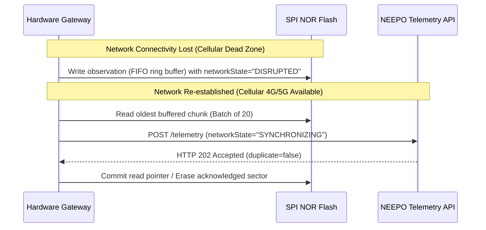

# NEEPO-CARE Hardware Sensor Gateway Contract & Interface Specification

This document specifies the architecture, hardware interface contracts, device authentication, offline flash buffering, electrical isolation, and safety requirements for connecting physical telematics units (OBD-II, CAN bus, temperature probes, and GPS) to the NEEPO-CARE platform.

> [!CAUTION]
> **Vehicle Safety Mandate**: Do not connect uncertified or experimental telematics hardware to an active vehicle on public roads. Physical hardware integration requires automotive electrical certification (ISO 7637-2), optoisolated read-only CAN bus taps, and safety sign-off. The software simulator remains the primary, reproducible test driver for CI and functional validation.

---

## 1. System Architecture

```mermaid
flowchart LR
    subgraph VehicleSensors["Vehicle & Cargo Sensors"]
        CAN["CAN Bus / OBD-II (Read-Only)"] --> MCU["Telematics Control Unit (MCU / STM32 / ESP32)"]
        GPS["GNSS Receiver (GPS/GLONASS)"] --> MCU
        TempProbe["Cargo RTD / 1-Wire Temp Probes"] --> MCU
    end

    subgraph HardwareGateway["Hardware Gateway Firmware"]
        MCU --> Flash["Encrypted NOR Flash Buffer (FIFO)"]
        MCU --> SecChip["Hardware Secure Element (ATECC608 / TPM)"]
        MCU --> Mod["4G LTE / 5G / Satellite Modem"]
    end

    Mod -->|HTTPS POST (mTLS / HMAC)| Ingress["NEEPO Edge Gateway (TLS 1.3)"]
    Ingress --> Backend["NEEPO-CARE Telemetry Ingestion Engine"]
```

---

## 2. Telemetry Ingestion Contract (JSON over HTTPS)

Physical gateway devices transmit observations to `POST /api/v1/telemetry` formatted identically to the canonical OpenAPI telemetry observation contract:

```json
{
  "eventId": "18f3a532-6a7f-44eb-9114-81628d09aa11",
  "tripId": "00000000-0000-4000-8600-000000000001",
  "vehicleId": "00000000-0000-4000-8300-000000000001",
  "recordedAt": "2026-09-06T14:20:00.000Z",
  "receivedAt": "2026-09-06T14:20:01.200Z",
  "expiresAt": "2026-09-06T14:25:00.000Z",
  "location": {
    "latitude": 11.42345,
    "longitude": 77.69123
  },
  "engineTemperatureCelsius": 96.5,
  "cargoTemperatureCelsius": 4.8,
  "speedKph": 48.0,
  "confidence": 0.99,
  "observationStatus": "FRESH",
  "source": "HARDWARE_GATEWAY",
  "networkState": "ONLINE"
}
```

### Sensor Field Specifications
| Parameter | Unit / Format | Valid Range | Resolution | Acquisition Method |
|---|---|---|---|---|
| `eventId` | UUID v4 | Random UUID | Unique per reading | Generated in MCU hardware RNG |
| `recordedAt` | ISO 8601 UTC | Within $\pm 5$ min of UTC | Milliseconds | GNSS PPS synchronized clock |
| `location.latitude` | Decimal degrees | -90.00000 to +90.00000 | 5 decimal places (~1.1m) | NMEA / UBX protocol from GNSS |
| `location.longitude`| Decimal degrees | -180.00000 to +180.00000| 5 decimal places (~1.1m) | NMEA / UBX protocol from GNSS |
| `engineTemperatureCelsius` | Degrees Celsius | -40.0 to +160.0 | 0.1 °C | OBD-II PID `0x05` / J1939 Engine Coolant Temp |
| `cargoTemperatureCelsius` | Degrees Celsius | -50.0 to +80.0 | 0.1 °C | Digital DS18B20 or PT100 RTD sensor |
| `speedKph` | Kilometers per hour | 0.0 to 220.0 | 0.1 km/h | OBD-II PID `0x0D` / Wheel speed sensor |
| `confidence` | Float (0.0 to 1.0) | 0.00 to 1.00 | 0.01 | Calculated based on HDOP & sensor health |
| `networkState` | Enum String | `ONLINE`, `SYNCHRONIZING`, `DISRUPTED` | - | Modem RSSI / network connection state |

---

## 3. Device Authentication & Hardware Security

1. **Hardware Secure Element**:
   - Each telematics unit contains a cryptographic secure element (e.g. Microchip ATECC608B or TPM 2.0) storing an immutable device private key generated during factory provisioning.
2. **Mutual TLS (mTLS)**:
   - Gateway establishes HTTPS connections using client certificate authentication issued by NEEPO Device CA (`CN=device-{vehicleId}.devices.neepo.io`).
3. **HMAC Device Fallback**:
   - For lightweight modems, device signs each HTTP payload using HMAC-SHA256 with timestamp verification:
     ```
     X-Device-Id: 00000000-0000-4000-8300-000000000001
     X-Device-Timestamp: 1788694800
     X-Device-Signature: 5a89f3... (HMAC-SHA256(secret, payload + timestamp))
     ```

---

## 4. Offline Flash Buffering & Replay Protocol



### Flash Storage Safeguards
- **Power-Loss Immunity**: Circular wear-leveling ring buffer in non-volatile SPI NOR flash (minimum 32MB, buffering $\ge 72$ hours of telemetry at 10s intervals).
- **Atomic Pointer Updates**: Read/write sector pointers written atomically to prevent record duplication across hardware power cycles.
- **Deduplication**: Each record retains its original `eventId` UUID assigned at physical acquisition time, guaranteeing idempotency if retransmitted.

---

## 5. Electrical, Thermal & Mechanical Safety Requirements

1. **Galvanic Isolation**:
   - CAN bus transceiver lines must include 2.5kV optical or digital isolation (e.g., ISO1050) to prevent ground loops or electrical transient spikes from propagating to the vehicle ECU.
2. **Read-Only CAN Bus Listening**:
   - Gateway microcontroller must operate in **Silent Mode** (Listen-Only Mode). Transmission pin (`TX`) must be physically pulled high or disconnected to guarantee zero transmission onto the vehicle control bus.
3. **Automotive Power Supply Protection**:
   - Input voltage: 9V–36V DC compatible with 12V and 24V vehicle electrical systems.
   - Transient surge protection according to ISO 7637-2 (handling load dump up to +87V and reverse polarity).
4. **Environmental Rating**:
   - Operational temperature range: $-40^\circ\text{C}$ to $+85^\circ\text{C}$.
   - Enclosure: IP67 water/dust ingress resistance with vibration damping (MIL-STD-810G).
