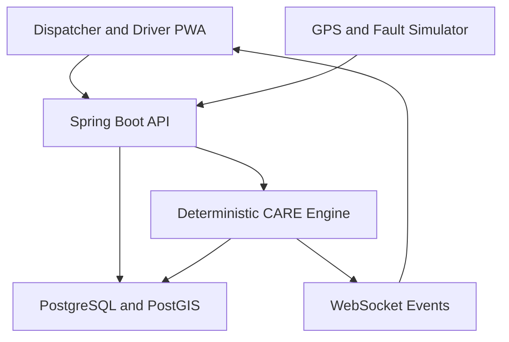

# NEEPO-CARE Prototype Architecture

The prototype is a modular monolith. Module boundaries are explicit, but deployment remains simple while the team validates rules and integration.

## Decision lifecycle

1. API accepts idempotent telemetry and stores the observation.
2. A context snapshot preserves values, timestamps, confidence and expiry.
3. CARE validates freshness and detects all active disruptions.
4. Recovery templates generate ordered candidate plans.
5. Independent hard evaluators reject unsafe plans.
6. Feasible plans receive benefit, risk and uncertainty values.
7. Deterministic selection stores utility, confidence and explanation codes.
8. WebSocket events update the UI only after state is persisted.
9. Monitoring invalidates a plan and begins one idempotent re-planning cycle when conditions change.

## Module boundaries

- Backend platform owns persistence, APIs, authentication, telemetry ingestion and event publication.
- CARE engine owns decision contracts and algorithms but not database entities or controllers.
- Frontend owns presentation, simulation and offline interaction but not business decisions.

Cross-module communication uses DTOs defined by `contracts/openapi.yaml`; database entities never cross module or API boundaries.
