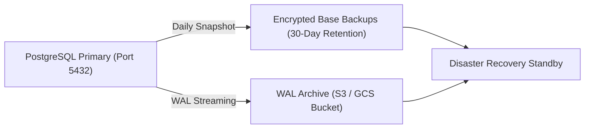
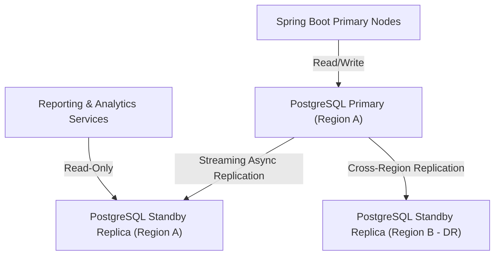

# NEEPO-CARE Database Reliability & Disaster Recovery Strategy

This document specifies the database architecture, backup procedures, point-in-time recovery (PITR), schema evolution principles, and high-availability design for PostgreSQL 17 + PostGIS in NEEPO-CARE.

---

## 1. Backup Strategy & Continuous Archiving

### Backup Architecture
NEEPO-CARE employs a tiered backup strategy combining full base backups with continuous Write-Ahead Log (WAL) archiving:



### Configuration Parameters (`postgresql.conf`)
```ini
wal_level = replica
archive_mode = on
archive_command = 'pgbackrest --stanza=neepo-care archive-push %p'
archive_timeout = 300 # Forces WAL switch every 5 minutes during low activity
max_wal_senders = 10
wal_keep_size = 4096MB
```

### Backup Schedule
- **Continuous WAL Archiving**: Near real-time streaming (RPO < 5 minutes).
- **Daily Differential Backups**: Executed at 01:00 UTC.
- **Weekly Full Base Backups**: Executed on Sundays at 02:00 UTC.
- **Offsite Encryption**: AES-256 server-side encryption enabled on backup storage buckets.

---

## 2. Point-In-Time Recovery (PITR) Procedure

To restore the database to a specific second before an operational disruption or accidental data alteration:

### Step 1: Prepare Recovery Directory
```bash
pgbackrest --stanza=neepo-care \
  --delta \
  --target="2026-09-06 14:30:00+00" \
  --target-action=promote \
  --type=time \
  restore
```

### Step 2: Configure Recovery Target (`postgresql.auto.conf`)
```ini
restore_command = 'pgbackrest --stanza=neepo-care archive-get %f "%p"'
recovery_target_time = '2026-09-06 14:30:00 UTC'
recovery_target_action = 'promote'
```

### Step 3: Start Server & Validate Schema
```bash
pg_ctl -D /var/lib/postgresql/data start
psql -U neepo_app -d neepo_care -c "SELECT pg_is_in_recovery();"
```

---

## 3. Data Retention & Partitioning Policy

### Partitioning Scheme
The high-volume `telemetry_observations` and `trip_context_snapshots` tables are range-partitioned by `recorded_at`:

- **Monthly Partitions**: `telemetry_observations_2026_09`, `telemetry_observations_2026_10`, etc.
- **Partition Indexing**: Local B-Tree indexes on `(trip_id, recorded_at DESC)` and PostGIS GiST index on `location`.

### Data Lifecycle
| Data Tier | Retention Window | Storage Medium | Action |
|---|---|---|---|
| **Hot Tier** | 0 – 90 days | High-IOPS NVMe SSD (PostgreSQL Primary) | Active real-time querying & CARE replanning |
| **Warm Tier** | 91 – 365 days | Standard SSD Read Replica | Analytical reporting and driver performance reviews |
| **Cold / Archive** | > 365 days | Compressed Parquet in Object Storage | Exported for compliance and model evaluation; dropped from OLTP |

---

## 4. Restore Verification & Disaster Recovery Drills

- **Automated Verification**: A weekly automated pipeline (e.g., GitHub Actions / Jenkins scheduled job) provisions an ephemeral PostgreSQL container, restores the latest base backup + WAL archives, runs integrity checks on table row counts and PostGIS spatial geometry validity, and reports status to the operations dashboard.
- **RTO & RPO Targets**:
  - **Recovery Point Objective (RPO)**: $\le 5$ minutes.
  - **Recovery Time Objective (RTO)**: $\le 30$ minutes.

---

## 5. Migration Strategy & Schema Evolution

### Immutable Forward-Only Principle
- Applied Flyway migrations `V1` through `V6` are strictly immutable.
- Any future schema evolution (new tables, column additions, index optimizations) must be authored as a new sequential migration (`V7__...sql`).

### Safe Evolution Rules
1. **Additive Changes**: Add new columns with `NULL` or default values; never alter or drop active columns in a single deployment.
2. **Concurrent Indexes**: In production, create large indexes using `CREATE INDEX CONCURRENTLY` to avoid table write locks.
3. **Pre-Deployment Validation**: Test all new migrations against a clean disposable database using `scripts/test-clean-database-migration.ps1` before merging.

---

## 6. Connection Pool Limits & Sizing

### HikariCP Configuration (Spring Boot)
HikariCP pool sizing follows the optimal PostgreSQL concurrency formula:
$$\text{Pool Size} = 2 \times \text{CPU Cores} + \text{Effective Spindle Count}$$

```yaml
spring:
  datasource:
    hikari:
      maximum-pool-size: 20
      minimum-idle: 5
      idle-timeout: 300000
      max-lifetime: 1200000
      connection-timeout: 20000
      leak-detection-threshold: 15000
```

### PgBouncer Middleware (Multi-Instance Scaling)
When scaling backend application instances beyond 5 replicas:
- Place PgBouncer between Spring Boot instances and PostgreSQL.
- **Pool Mode**: `transaction`.
- **Default Pool Size**: 50 shared server connections supporting up to 500 client threads.

---

## 7. Read-Replicas & Multi-Region Considerations



1. **Read/Write Splitting**:
   - Write operations (telemetry ingestion, trip lifecycle changes, CARE recovery plan generation) target Primary DB.
   - Read-heavy operations (fleet historical queries, telemetry maps, dispatcher dashboard overviews) route to Read Replica.
2. **PostGIS Spatial Query Optimization**:
   - All spatial columns (`location`, `service_area`) use GiST spatial indexing (`CREATE INDEX USING GIST (location)`).
   - Distance queries use `ST_DWithin` with geography casts for accurate ellipsoidal metric calculations without planar distortion.
