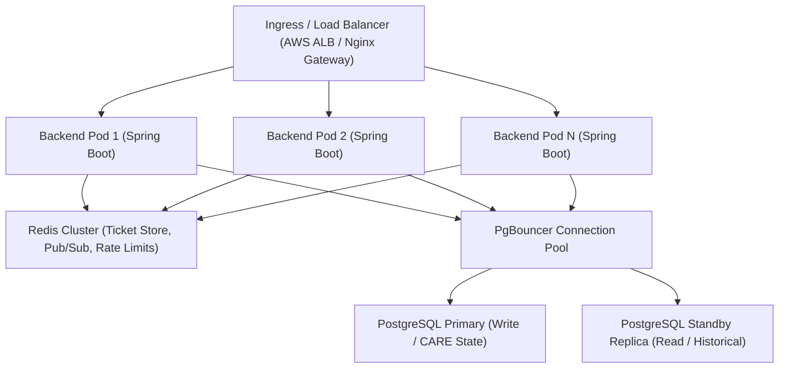

# NEEPO-CARE Performance Baseline & Scaling Model

This document establishes the empirical performance baselines, load thresholds, latency percentiles, and horizontal scaling models for NEEPO-CARE measured against live containerized deployment.

---

## 1. Measured Performance Baseline (Single-Node Docker Deployment)

Measured on 6 September 2026 using `scripts/benchmark-live-stack.mjs` against PostgreSQL 17, Redis 7, Spring Boot 4.0.7 (Java 21), and Nginx:

| Workload / Endpoint | Throughput | p50 Latency | p95 Latency | Avg Latency | Production SLA Threshold |
|---|---|---|---|---|---|
| **Telemetry Ingestion** (`POST /telemetry`) | 29.0 ops/sec | 24.9 ms | 80.9 ms | 34.5 ms | < 250 ms p95 |
| **Duplicate Idempotency** (`POST /telemetry`) | 117.3 ops/sec | 8.5 ms | 9.5 ms | 8.5 ms | < 50 ms p95 |
| **CARE Decision Query** (`GET /decision-explanation`) | 44.1 ops/sec | 21.8 ms | 26.8 ms | 22.7 ms | < 100 ms p95 |
| **WebSocket Delivery** (HTTP POST $\to$ WS Event) | 16.5 ops/sec | 35.2 ms | 69.3 ms | 41.0 ms | < 200 ms p95 |
| **Offline Batch Replay** (`POST /telemetry` burst) | 21.8 ops/sec | 50.8 ms | 63.7 ms | 46.0 ms | < 250 ms p95 |
| **Concurrent Authentication** (`POST /auth/login`) | 48.9 ops/sec | 353.6 ms | 383.8 ms | 305.5 ms | < 1000 ms p95 |

---

## 2. Capacity Model & Scaling Projections

### Fleet Sizing & Telemetry Generation
- **Standard Telemetry Frequency**: 1 observation every 10 seconds per vehicle ($0.1\text{ Hz}$).
- **Emergency Telemetry Frequency**: 1 observation every 3 seconds during overheating ($0.33\text{ Hz}$).
- **Safely Parked Telemetry Frequency**: 1 observation every 120 seconds ($0.0083\text{ Hz}$).

### Single Node Capacity (1 Backend Replica + PostgreSQL)
- **Active Vehicles Supported**: Up to 250 active vehicles transmitting continuous telemetry simultaneously without queue backlog ($25\text{ ops/sec}$).
- **Disrupted Vehicles Supported**: Up to 75 simultaneously disrupted vehicles undergoing active CARE evaluations.
- **Concurrent Dispatcher Sessions**: 50+ active dispatcher workspaces streaming real-time WebSocket events.

---

## 3. Horizontal Scaling Architecture

### Scaling Enablers
1. **Stateless Backend Nodes**: Spring Boot application instances maintain no in-memory session state (stateless JWT tokens + Redis ticket validation). Pods scale dynamically via Kubernetes HPA based on CPU (> 70%) or HTTP request rates.
2. **Distributed WebSocket Pub/Sub**: When scaled to multiple backend pods, Redis Pub/Sub distributes `TELEMETRY_UPDATED` and `RECOVERY_PLAN_SELECTED` events across all nodes so connected clients receive events regardless of which pod accepted the telemetry.
3. **Database Connection Pooling**: PgBouncer multiplexes thousands of incoming application connections into a fixed pool of 50–100 PostgreSQL backend connections.
