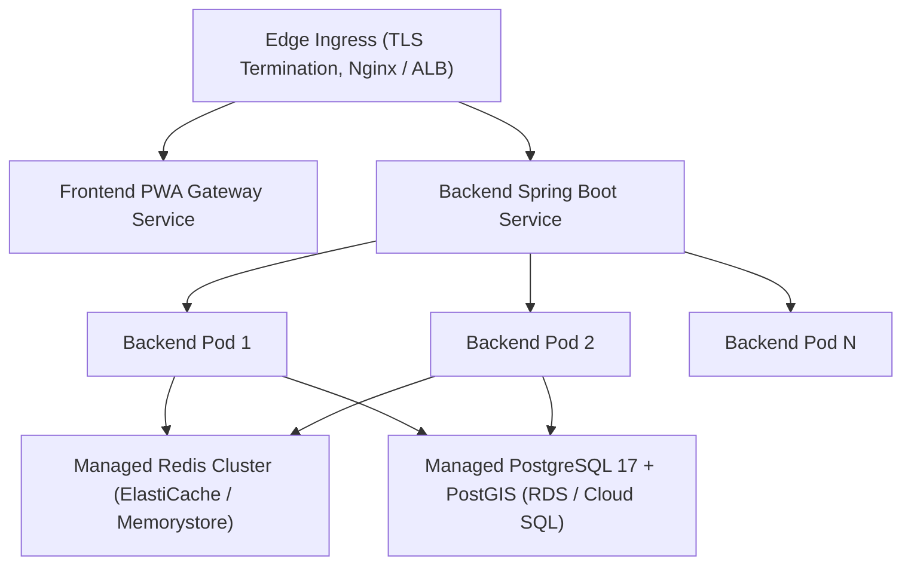

# NEEPO-CARE Production Deployment & Operations Guide

This guide details deployment options, infrastructure topology, container management, secrets provisioning, disaster recovery, zero-downtime upgrades, and rollback procedures for NEEPO-CARE.

---

## 1. Deployment Topologies

### Topology A: Multi-Container Docker Compose (On-Prem / Single VM)
Ideal for branch deployments, edge stations, staging, or isolated demonstrations.

```bash
# 1. Clone repository and verify release
git clone https://github.com/neepo/neepo-care.git
cd neepo-care

# 2. Configure production environment file (.env)
cp .env.example .env
# Edit .env with strong secrets (min 32 bytes for JWT_SECRET)

# 3. Build and launch services
docker compose config --quiet
docker compose up -d --build

# 4. Validate health
curl -f http://localhost:3000/health
curl -f http://localhost:8080/actuator/health
```

### Topology B: Kubernetes / Cloud Container Deployment (AWS EKS / GKE / AKS)



#### Kubernetes Manifest Snippet (Backend Deployment)
```yaml
apiVersion: apps/v1
kind: Deployment
metadata:
  name: neepo-backend
  namespace: neepo-prod
spec:
  replicas: 3
  strategy:
    type: RollingUpdate
    rollingUpdate:
      maxSurge: 1
      maxUnavailable: 0
  selector:
    matchLabels:
      app: neepo-backend
  template:
    metadata:
      labels:
        app: neepo-backend
    spec:
      containers:
        - name: backend
          image: 123456789012.dkr.ecr.region.amazonaws.com/neepo-backend:v1.0.0
          envFrom:
            - secretRef:
                name: neepo-backend-secrets
            - configMapRef:
                name: neepo-backend-config
          ports:
            - containerPort: 8080
          resources:
            requests:
              memory: "1Gi"
              cpu: "500m"
            limits:
              memory: "2Gi"
              cpu: "2000m"
          livenessProbe:
            httpGet:
              path: /actuator/health/liveness
              port: 8080
            initialDelaySeconds: 30
            periodSeconds: 10
          readinessProbe:
            httpGet:
              path: /actuator/health/readiness
              port: 8080
            initialDelaySeconds: 15
            periodSeconds: 5
```

---

## 2. Ingress & TLS Configuration

```yaml
apiVersion: networking.k8s.io/v1
kind: Ingress
metadata:
  name: neepo-ingress
  namespace: neepo-prod
  annotations:
    cert-manager.io/cluster-issuer: letsencrypt-prod
    nginx.ingress.kubernetes.io/ssl-redirect: "true"
    nginx.ingress.kubernetes.io/proxy-body-size: "10m"
    nginx.ingress.kubernetes.io/websocket-services: "neepo-backend"
spec:
  ingressClassName: nginx
  tls:
    - hosts:
        - care.neepo.io
      secretName: neepo-tls-cert
  rules:
    - host: care.neepo.io
      http:
        paths:
          - path: /api/
            pathType: Prefix
            backend:
              service:
                name: neepo-backend
                port:
                  number: 8080
          - path: /ws
            pathType: Prefix
            backend:
              service:
                name: neepo-backend
                port:
                  number: 8080
          - path: /
            pathType: Prefix
            backend:
              service:
                name: neepo-frontend
                port:
                  number: 80
```

---

## 3. Secret Management & Ingestion

1. **Vault / AWS Secrets Manager**:
   - Store `JWT_SECRET`, `SPRING_DATASOURCE_PASSWORD`, and `REDIS_PASSWORD` in encrypted secret stores.
   - Synchronize secrets into Kubernetes Secrets via External Secrets Operator (`ESO`) or CSI Secret Store driver.
2. **Never Mount Secrets in Static Files**:
   - Do not commit `.env` or configuration files with credentials.
   - Run `python scripts/validate-foundation.py` to ensure local repository integrity.

---

## 4. PostgreSQL Operations & Backup

1. **Daily Automated Snapshots**:
   - Retain daily backups for 30 days; weekly full snapshots for 1 year.
2. **WAL Archiving**:
   - Continuous WAL streaming with RPO $\le 5$ minutes.
3. **Restoration Drill**:
   - Test restore operations monthly into a disposable environment using `scripts/test-clean-database-migration.sh`.

---

## 5. Monitoring, Health Checks & Alerting

### Prometheus Metrics Endpoints
- Backend metrics: `http://<backend>:8080/actuator/prometheus` (protected/internal port).
- PostgreSQL exporter: Port 9187.
- Redis exporter: Port 9121.

### Key Operational Alerts
| Metric | Threshold | Severity | Action |
|---|---|---|---|
| HTTP 5xx Rate | > 1% over 5 min | Critical | Inspect backend logs for unhandled exceptions |
| CARE Decision Latency | p95 > 250ms | Warning | Check PostgreSQL connection pool and query locks |
| Inactive Telemetry Gap | Active trip without telemetry for 60s | Warning | Alert dispatcher and evaluate policy transition |
| Database Connections | Active connections > 85% pool capacity | Warning | Scale PgBouncer or investigate connection leaks |
| Redis Memory Usage | > 80% maxmemory | Critical | Inspect key TTLs and eviction rates |

---

## 6. Zero-Downtime Upgrade Procedures

1. **Build & Test Release**:
   - Run clean validation suite (`validate-foundation.py`, `test-clean-database-migration.ps1`, `validate-live-stack.mjs`).
   - Generate release package via `scripts/package-release.ps1`.
2. **Apply Additive Flyway Migrations**:
   - Execute new migration `V(N)__...` before rolling backend pods. Because migrations are strictly backward-compatible, existing backend pods continue running without disruption.
3. **Rolling Pod Deployment**:
   - Apply Kubernetes deployment update:
     ```bash
     kubectl set image deployment/neepo-backend backend=neepo-backend:v1.1.0 -n neepo-prod
     kubectl rollout status deployment/neepo-backend -n neepo-prod
     ```
4. **Deploy Frontend PWA**:
   - Deploy new static assets with fingerprinted bundles. The service worker precaches new chunks seamlessly on user revisit.

---

## 7. Emergency Rollback Procedures

### Application Rollback
If a critical defect is identified post-release:
```bash
kubectl rollout undo deployment/neepo-backend -n neepo-prod
kubectl rollout undo deployment/neepo-frontend -n neepo-prod
```

### Database Rollback Strategy
- Since all schema migrations follow additive forward-only principles (no destructive column drops), the previous backend version remains compatible with the current schema.
- In catastrophic data corruption scenarios, execute Point-In-Time Recovery (PITR) following [DATABASE_RELIABILITY.md](file:///d:/Projects/NEEPO-CARE-feature-full-stack-integration-2026-09-02/neepo-care-prototype/docs/architecture/DATABASE_RELIABILITY.md).
