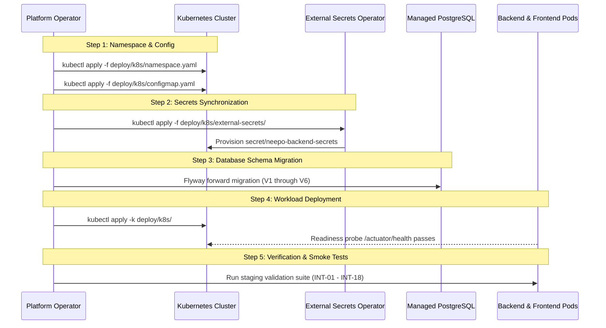

# NEEPO-CARE Staging Deployment Operator Checklist

This document provides a step-by-step checklist and operational runbook for platform and DevOps engineers deploying NEEPO-CARE to a staging Kubernetes environment (AWS EKS, GCP GKE, or self-hosted).

---

## 1. Cloud & Infrastructure Prerequisites Checklist

| Component | Requirement | Verification Command / Dry-Run |
|---|---|---|
| **Kubernetes Cluster** | v1.28+ with OIDC authentication | `kubectl cluster-info` |
| **Ingress Controller** | ingress-nginx v1.9+ | `kubectl get pods -n ingress-nginx` |
| **Cert-Manager** | v1.13+ for Let's Encrypt TLS | `kubectl get pods -n cert-manager` |
| **PostgreSQL** | Managed RDS PostgreSQL 17 + PostGIS 3.5 | `psql -h <POSTGRES_HOST> -U neepo_user -d neepo_care -c "SELECT postgis_version();"` |
| **Redis** | ElastiCache Redis 7.2+ | `redis-cli -h <REDIS_HOST> -p 6379 ping` |
| **External Secrets Operator** | ESO v0.9.9+ | `kubectl get pods -n external-secrets` |
| **Container Registry** | AWS ECR / GCP Artifact Registry | `aws ecr describe-repositories --repository-names neepo-backend neepo-frontend` |

---

## 2. IAM & Role-Based Access Control

1. **Kubernetes Service Accounts**:
   - Backend Pod Service Account: `neepo-backend-sa` annotated with cloud IAM role (`eks.amazonaws.com/role-arn: arn:aws:iam::<ACCOUNT_ID>:role/NeepoBackendSecretsReader`).
2. **Secrets Manager Policy**:
   - Grant read-only access to `staging/neepo-care/*` secrets:
   ```json
   {
     "Version": "2012-10-17",
     "Statement": [
       {
         "Effect": "Allow",
         "Action": ["secretsmanager:GetSecretValue", "secretsmanager:DescribeSecret"],
         "Resource": "arn:aws:secretsmanager:<REGION>:<ACCOUNT_ID>:secret:staging/neepo-care/*"
       }
     ]
   }
   ```

---

## 3. Deployment Sequence (Step-by-Step)



### Dry-Run Execution:
To test and validate the manifests before making changes:
```powershell
# Validate manifest structure offline
powershell -ExecutionPolicy Bypass -File .\scripts\validate-staging-manifests.ps1

# Render Kustomize manifests to standard output without applying
kubectl kustomize deploy/k8s/
```

---

## 4. Health Verification & Smoke Tests

Once deployed, run the automated staging verification test suite:

```powershell
$env:NEEPO_GATEWAY_URL = "https://staging.neepo.io"
$env:NEEPO_BACKEND_URL = "https://staging.neepo.io/api"
$env:NEEPO_TEST_PASSWORD = "<STAGING_OPERATOR_PASSWORD>"
node scripts/validate-staging-deployment.mjs
```

---

## 5. Emergency Rollback Protocol

If smoke tests fail or an unhandled alert triggers during staging promotion:

```bash
# 1. Rollback backend deployment immediately
kubectl rollout undo deployment/neepo-backend -n neepo-care

# 2. Rollback frontend deployment
kubectl rollout undo deployment/neepo-frontend -n neepo-care

# 3. Verify rollback health status
kubectl rollout status deployment/neepo-backend -n neepo-care
curl -f https://staging.neepo.io/actuator/health
```
